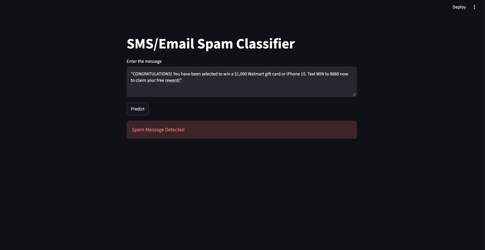
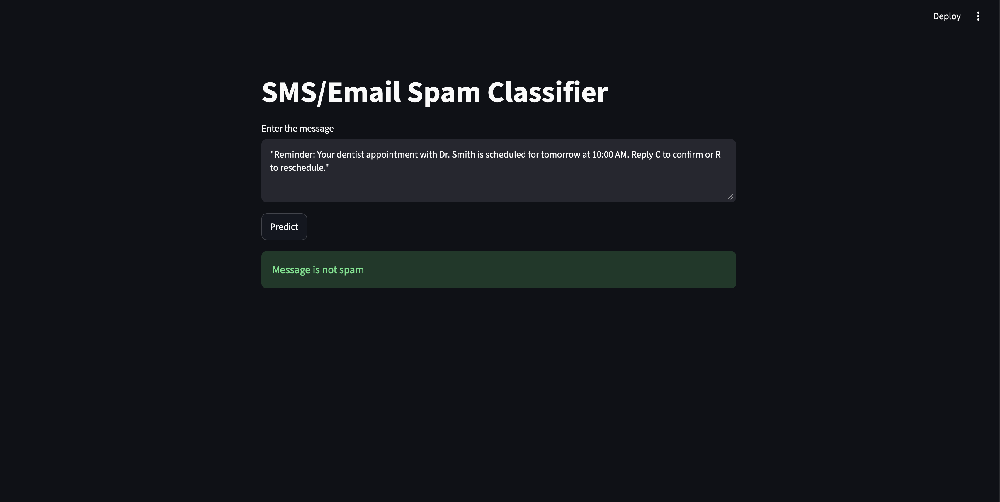

# SMS & Email Spam Classifier

An end-to-end machine learning project that classifies SMS and email messages as **Spam** or **Not Spam** using Natural Language Processing (NLP), Scikit-learn, and Streamlit.

The project includes data cleaning, exploratory data analysis, text preprocessing, TF-IDF feature extraction, model experimentation, evaluation, and an interactive web application for message classification.

## 🚀 Live Demo

Try the application here:
[SMS/Email Spam Classifier](https://sms-email-spam-classify.streamlit.app)

## Features

- Classifies messages as Spam or Not Spam
- NLP-based text preprocessing using NLTK
- TF-IDF feature extraction
- Comparison of multiple machine learning algorithms
- Ensemble learning experiments using Voting and Stacking classifiers
- Interactive Streamlit web interface
- Real-time message prediction using a saved model
- Exploratory data analysis and text visualizations

## Tech Stack

| Technology | Purpose |
|---|---|
| Python | Core programming language |
| Pandas | Data manipulation and analysis |
| Scikit-learn | Machine learning and model evaluation |
| NLTK | Text preprocessing and stemming |
| TF-IDF | Text feature extraction |
| Streamlit | Interactive web application |
| Matplotlib / Seaborn | Data visualization |
| WordCloud | Frequent-word visualization |
| Jupyter Notebook | Model development and experimentation |

## Project Workflow

### 1. Data Cleaning
- Loaded and explored the SMS spam dataset
- Removed unnecessary columns
- Renamed target and message columns
- Encoded spam/ham labels
- Removed duplicate messages

The dataset contained **5,169 messages after cleaning and duplicate removal**.

### 2. Exploratory Data Analysis
Performed analysis of:
- Spam and non-spam message distribution
- Message length
- Word and sentence counts
- Frequently occurring words
- Spam and non-spam word clouds

### 3. Text Preprocessing
Implemented a custom preprocessing function using NLTK:

1. Convert text to lowercase
2. Tokenize the message
3. Remove non-alphanumeric tokens
4. Remove English stopwords
5. Apply Porter stemming
6. Join the processed tokens

### 4. Feature Extraction
Used `TfidfVectorizer` with `max_features=3000` to convert text messages into numerical features for machine learning.

### 5. Model Training and Evaluation
Experimented with multiple classifiers, including:

- Multinomial Naive Bayes
- Bernoulli Naive Bayes
- Gaussian Naive Bayes
- Support Vector Classifier
- K-Nearest Neighbors
- Decision Tree
- Logistic Regression
- Random Forest
- Extra Trees
- Bagging Classifier

Also explored ensemble approaches using:
- Soft Voting Classifier
- Stacking Classifier

Models were evaluated using **Accuracy** and **Precision**.

## Model Results

| Model | Accuracy | Precision |
|---|---:|---:|
| Multinomial Naive Bayes | 97.29% | 100.00% |
| Bernoulli Naive Bayes | 98.26% | 99.18% |
| Support Vector Classifier | 97.58% | 97.48% |
| Random Forest | 96.91% | 97.32% |
| Extra Trees | 97.87% | 97.54% |
| Soft Voting Classifier | 98.16% | 99.17% |
| Stacking Classifier | 97.87% | 93.28% |

**Final selected model: Multinomial Naive Bayes**

The Multinomial Naive Bayes model was selected based on its precision of 100% in the recorded evaluation, making it suitable for the project's text-classification task.

*Evaluation results are from the notebook's 80/20 train-test split. TF-IDF was fitted before the split in the original experiment, so the results may be somewhat optimistic due to data leakage.*

## Project Structure

```text
SMS-Email-Spam-Classifier/
│
├── application.py
├── preprocessing.py
├── model.pkl
├── vectorizer.pkl
├── sms-spam-detection.ipynb
├── spam.csv
├── requirements.txt
├── .gitignore
└── README.md
```

## Installation and Setup

### 1. Clone the repository

```bash
git clone https://github.com/VardaanSharma18/SMS-Email-Spam-Classifier.git
cd SMS-Email-Spam-Classifier
```

### 2. Create a virtual environment

```bash
python3 -m venv .venv
```

Activate it:

**macOS / Linux**
```bash
source .venv/bin/activate
```

**Windows**
```bash
.venv\Scripts\activate
```

### 3. Install dependencies

```bash
pip install pandas scikit-learn nltk streamlit numpy matplotlib seaborn wordcloud
```

### 4. Download required NLTK resources

```bash
python -c "import nltk; nltk.download('punkt'); nltk.download('punkt_tab'); nltk.download('stopwords')"
```

### 5. Run the application

```bash
streamlit run application.py
```

The Streamlit application will open in your browser.

## Application Screenshots

### Spam Message Detected


### Legitimate Message Detected


## How to Use

1. Launch the Streamlit application.
2. Enter or paste an SMS or email message.
3. Click **Predict**.
4. View the classification result:
   - Spam Message Detected
   - Message is not spam

## Future Improvements

- Deploy the application for public access
- Improve evaluation using a leakage-free ML pipeline
- Expand the dataset with more diverse spam examples
- Add recall, F1-score, and confusion matrix visualizations
- Improve detection of sophisticated spam and phishing messages

## Author

**Vardaan Sharma**

GitHub: [VardaanSharma18](https://github.com/VardaanSharma18)

---

If you found this project interesting, consider giving the repository a ⭐.
